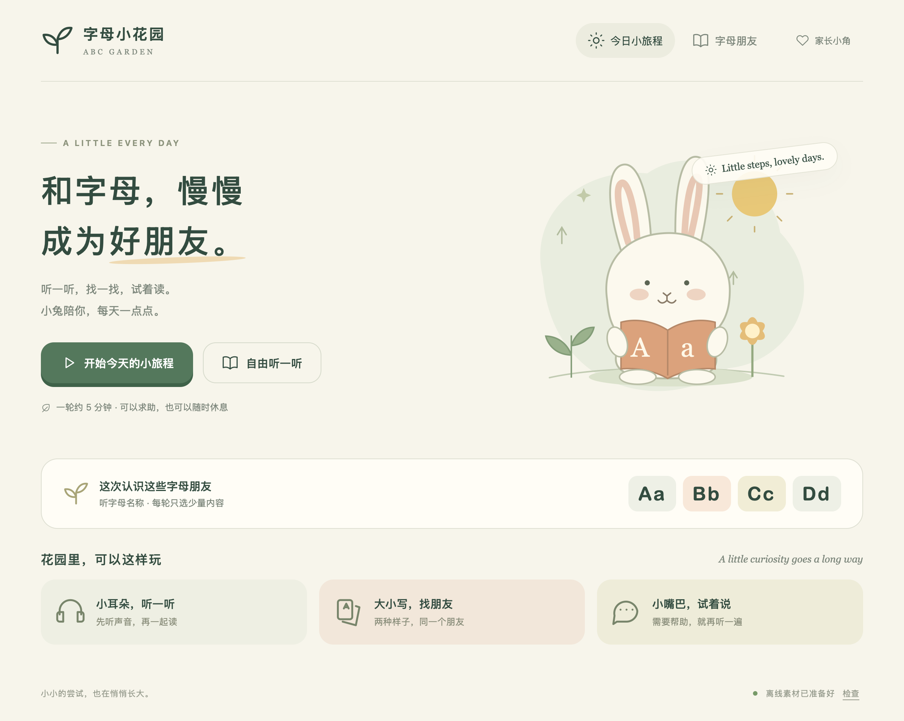

# ABC小花园 · ABC Garden

花园系列的英语学习网页，面向 iPad。包含26个字母的大小写、名称与基础字母音，配合词汇、故事、对话和写作。短时练习、随时求助、自然结束。



界面设计约定见 [家长弹窗与应用更新](docs/ui-guidelines.md)。

## 开始使用

1. 首页提供「字母朋友」「看图学词」「成长地图」三个并列入口，无需解锁。
2. 「字母朋友」提供认识字母、大小写配对、听音找字母、字母跟唱。认识字母页可进入家长陪同的「一起学字母」。字母卡片、点读和练习共用已保存的范围，新配置默认 E–H。听音找字母默认按名称、大写、慢慢练习，玩法可在活动设置中调整。
3. 「看图学词」默认进入家长选定的“正在学”，也可浏览“词库”或复习“已掌握”。「成长地图」提供故事小屋、开口说一说和小小写作室。分层练习供自由选择，录音回听和写作导出由孩子主动操作。
4. 长按进入「家长小角」，可调整设备朗读声音、编辑词卡、管理离线素材和应用更新。字母和单词学习范围在各自模块调整。
5. 页面会准备轻量离线界面；图片按显示需要加载，音频点击才加载。需完整断网练习时，在家长小角按“词卡图片、单词读音、例句读音、其他内容”分类下载，或点击“下载全部素材”，查看空间估计并确认后下载。Safari 可通过「分享 → 添加到主屏幕」安装。

导航随屏幕宽度切换：1100px 起使用左侧栏，家长小角放在侧栏底部；较窄屏幕使用顶部图文导航，家长入口收为右上角盾牌图标，760px 及以下三个学习入口单独排一行。首页在内容区不足900px时改为一列横向学习卡，适配iPad竖屏；看图学词按内容区宽度调整左右分栏。家长入口仍需长按1秒进入。

浏览器标签标题随页面和成长地图内的活动更新，格式为“当前页面 · ABC小花园”；首页为“ABC小花园 · ABC Garden”。

短时练习、随时求助，不做自动口语评分、掌握率、排名或连续打卡惩罚。组合拼读已移除。

## 声音与课程

- 「字母朋友 → 字母设置」可整套选择培训班录音（GK）或 EdCreate，默认 EdCreate。每套都包含 A–Z 的名称音和字母音，点读、循环听、大小写配对和听音找字母共用选择。设置页可单独试听，选择保存在本机。
- 英文例词、故事和对话使用 Kokoro 82M v1.0，`af_heart` 美式女声、0.9 倍语速。中文引导使用 Kokoro 1.1 中文模型、`zf_001` 女声。固定音频随网站分发，无需在 iPad 运行模型。
- 大小写共用名称和字母音。字母音只是基础参考，Q 为 /kw/、X 为 /ks/，不覆盖全部发音规则；课程和合成音未经教师逐条审核。
- 单词点播和「循环听」使用内置英文单词录音与设备中文声音，循环听只读单词和释义。家长小角可编辑中文释义、英文例句及译文，也可恢复默认。修改保存在本机。扩展词例句及修改过的英文例句使用系统英文声音，可在家长小角选择音色与语速。
- 认识字母的循环听可选每项 1／2／3 遍，播放中调整从下一字母生效。兼容的 iPad 主屏幕 Web App 可熄屏继续字母循环听，单词循环听仍按后台暂停处理。实际锁屏控制及音量需在真机确认。

音频记录见 `assets/audio/sources.json`、`assets/audio/course-sources.json` 和 `assets/audio/{edcreate,gk}/imported.json`。模型采用 Apache-2.0 许可：[英文模型](https://huggingface.co/onnx-community/Kokoro-82M-v1.0-ONNX)、[中文模型](https://huggingface.co/onnx-community/Kokoro-82M-v1.1-zh-ONNX)。模型不随网页分发；第三方素材与用户录音另有来源边界。

## 本机数据

家长配置、内置词的选词顺序、掌握标记及陪学进度存放在当前浏览器。写作草稿和临时录音仅在当前会话保留。没有账号、分析追踪或跨设备同步，清除网站数据会丢失本机记录。

主动录音不上传服务器。本地开发的 `/api/speech` 用于语音生成。家长入口长按 1 秒进入，提前松手、滑动、失焦或切到后台会取消。它用于防误触。

## 本地开发

需要 Node.js 20+。

```sh
npm ci
npm run dev
```

打开终端显示的本地地址，默认 `http://localhost:4173/`。修改后运行 `npm run build` 再刷新。固定素材练习使用本地资源。

```sh
npm test                 # 选题、内容校验、兼容数据和接口规则
npm run build            # 检查音频并生成 dist/
npx playwright install chromium webkit
npm run test:e2e         # iPad 尺寸，Chromium + WebKit
npm run test:subpath     # 项目子路径、Range 与断网播放
```

如需要重新生成英文示范：

```sh
npm run audio
```

首次会下载约90MB模型到开发环境缓存，模型不进入 Git 仓库和网页。后续在本地 CPU 生成 WAV。单独的 A 使用明确的 /eɪ/ 输入，避免普通文本 TTS 把 A 当作不定冠词。

如只补充示例词，运行 `node scripts/generate-examples.mjs`。中文提示音单独生成，需要带 SSL 支持的 Python 3.10+ 和 Misaki 中文前端：

```sh
python3 -m venv /tmp/abc-audio-env
/tmp/abc-audio-env/bin/pip install -r scripts/requirements-audio.txt
ABC_TTS_PYTHON=/tmp/abc-audio-env/bin/python node scripts/generate-prompts.mjs
```

中文模型另下载到开发缓存。所有产物为单声道 PCM16 WAV；修改提示文案后，重新生成音频，再构建发布，避免各设备音色不同。

## 修改入口

| 文件 | 职责 |
| --- | --- |
| `app/content.js` | 字母、示范音、拼读组合、中文引导文本 |
| `app/core.js` | 选题、按能力记录、恢复与备份校验 |
| `app/main.js` | 首页、字母朋友、单词入口、家长设置与路由 |
| `app/learning-content.js`、`app/word-library.js` | 本机内容修订、选词保存与规范词卡映射 |
| `app/course-content.js`、`app/course.js` | 词汇、故事、对话和写作数据及其界面 |
| `app/letter-audio.js`、`app/letter-audio-settings.js` | 字母音源解析、试听与保存 |
| `data/reference-dictionary/` | 旧字典扩词参考及来源许可，不打包到应用 |
| `app/generated-audio.js` | 生成接口、IndexedDB 音频缓存 |
| `app/audio.js` | 中英文固定音频队列、取消与防重叠 |
| `app/styles.css`、`app/art.js` | iPad／手机布局与原创 SVG 插图 |
| `sw.js` | 统一素材缓存、包引用、下载续传、完整性检查和音频 Range 响应 |
| `app/offline.js` | 下载空间评估、确认、进度与清理界面 |
| `app/mastery.js` | 单词掌握规则、手动覆盖与独立存储 |

三个维护要点：

1. 已保存的字母范围统一存放在模块配置中；修改入口在 `app/main.js` 的保存设置处理，避免多个页面各自维护一份范围。
2. `LearningContent` 管理家长选择与排序；`word-library.js` 将选择ID映射到唯一词库；固定字母音频仍由字母库负责。
3. 换题、切换来源和离开页面都应取消声音；IndexedDB 存储 WAV 的 ArrayBuffer，读取时还原 Blob，同时兼容旧 Blob 数据。离线固定音频继续支持 Range 请求。

## 服务器发布

正式地址：[打开花园](https://nmwei.cn/abc-garden/)。GitHub 保留源码，发布脚本不再推送 `main` 或 `gh-pages`，源码推送单独进行。

需要 Node.js 20+、SSH 和 rsync。服务器已配置独立部署账号，默认连接 `garden-deploy@106.15.155.26`，本机专用密钥位于 `~/.ssh/garden_deploy_nmwei`；私钥不进入仓库。换电脑需安全配置自己的部署权限，并通过可信渠道核对服务器主机指纹，不关闭 SSH 主机校验。

```sh
npm run deploy -- --dry-run             # 构建、冻结快照和校验，不连接服务器
npm run deploy                         # 发布当前项目
npm run deploy -- --rollback           # 切回本项目上一个成功版本
```

默认从 `main` 的干净工作区发布。确需发布已经审阅、尚未提交的改动时，显式加 `--allow-dirty`；版本元数据会记录 `dirty: true`，不会自动暂存、提交或推送。`--host user@host`、`--key /absolute/key` 可覆盖 SSH 配置，也支持 `GARDEN_DEPLOY_HOST`、`GARDEN_DEPLOY_KEY`。

执行链路：重新构建 → 冻结 `dist/` 快照 → 按哈希增量上传到本项目独立版本目录 → 服务器逐文件校验 → 原子切换 `current` → 内部 HTTP 核对。检查失败自动恢复旧入口；上传失败不切换。根目录 `_release.json` 提供源码提交、发布编号及工作区状态。发布后还应核对正式 HTTPS 地址，脚本的内部检查不能替代公网或真实 iPad 验收。

发布产物仅包含静态页面与学习素材，不上传 Git、环境变量、依赖和本机学习数据。旧版本保留供回退；磁盘清理需保留 `current`、`previous` 指向的版本，不自动删除历史发布。三个仓库的发布工具副本保持一致，修改公共发布逻辑时同步三个仓库并运行发布测试。

旧 GitHub Pages 暂时保留迁移期间的访问能力，后续不再更新。旧域名里的学习记录不会自动进入新域名，旧主屏幕图标仍指向旧站；账号/云端同步和完整数据迁移另行实现，先保留旧站数据。

## 学习范围与离线

- 在「看图学词」详情可加入或移出正在学，排序在正在学列表里保存。移出不会清除掌握记录。已掌握词可重新学习，重新开始积累证据。
- 看图学词提供看图听词、听音找图、试着说和拼一拼。听音找图答错有一次重试机会，答对后完成反馈并自动继续。拼写答对后由孩子手动进入下一题，录音由孩子主动回听。
- 自动掌握只计听完题目、未用提示且首次答对的直接识图练习。最近三次有效答题覆盖至少两个本地日期时标为已掌握，也可手动标记或取消。情境提示图用例句学习，录音、拼写及提示用于练习。
- 离线素材可按词卡图片、单词读音、例句读音和其他内容下载，支持同一版本内的暂停续传。页面会显示空间估计，下载期间保持页面打开。清理素材独立于本机学习记录。
- 正式版检查更新后仍使用当前页面，点击「重新加载并回首页」才启用待更新版本。新版激活会清理本站旧版缓存，所需素材需重新下载，本机学习记录保留。开发时用 `?offline-test=1` 验证正式站等待更新的流程。

## 素材维护

- 增加故事、对话或例句后，用 `npm run audio:course` 生成所需音频。修改已有句子时先处理对应的旧音频。词卡来源、语境图边界及生成命令见[词库维护](docs/vocabulary-content.md)。
- 两套字母录音的原文件、切点及输出哈希位于 `assets/audio/gk/` 和 `assets/audio/edcreate/`。重新生成运行 `node scripts/import-letter-audio.mjs`，可指定 `gk` 或 `edcreate`。导入与构建校验分段、音频格式和哈希，发音仍需试听核对。
- 答对使用 Mixkit A2 和 1.4 秒小花反馈，答错使用 B2。覆盖大小写配对、听音找字母、听音找图、拼写和故事理解。播放及取消在 `app/feedback-audio.js`，来源和处理哈希见[音效记录](assets/audio/feedback-sources.json)。
- 字母活动的剩余高度分配与换组由 `app/letter-layout.js` 处理，极矮或窄屏保留自然滚动。全量重建静态产物可用 `node scripts/build.mjs --clean`。

## 专题资料

- [字母一起学](docs/guided-letters.md)与[单词陪学引擎](docs/guided-learning-engine.md)说明策略、进度和学习证据边界。
- [历次验收](docs/acceptance.md)与[Wonders GK 覆盖](docs/wonders-gk-coverage.md)保留对应阶段的记录。
- [国内访问及云存档计划](docs/domestic-launch/plan.md)记录上线取舍和待确认事项。
